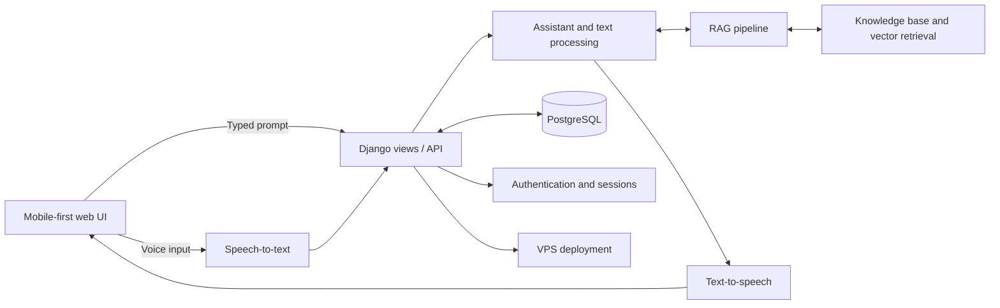

# Yuguu AI

A planned mobile-first voice assistant web application built with Django, PostgreSQL, and retrieval-augmented generation (RAG). The interface centers on two actions: a **green Voice-to-Text** button and a **red Text-to-Voice** button.

## Architecture

## Planned components

- **Mobile interface:** Responsive assistant screen with green Voice-to-Text and red Text-to-Voice controls, transcript, and response display.
- **Voice input and STT:** Microphone capture, transcription, and input validation.
- **Assistant layer:** Prompt handling, conversation flow, and response orchestration.
- **RAG:** Document ingestion, chunking, embeddings, vector retrieval, and context-grounded responses.
- **TTS:** Convert assistant responses to speech for playback.
- **Django backend/API:** UI delivery, request handling, and endpoints connecting the application modules.
- **PostgreSQL:** Persistent storage for users, sessions, conversation history, and application records.
- **Authentication and sessions:** User sign-in and private conversation access, if enabled.
- **VPS deployment:** Production hosting, application server, reverse proxy, HTTPS, environment configuration, and process management.
- **Supporting modules:** Configuration and secrets, logging, error handling, file/document management, and static/media asset handling.

## Technology outline

- **Web framework:** Django
- **Database:** PostgreSQL
- **AI workflow:** RAG with a vector retrieval component
- **Hosting:** VPS
